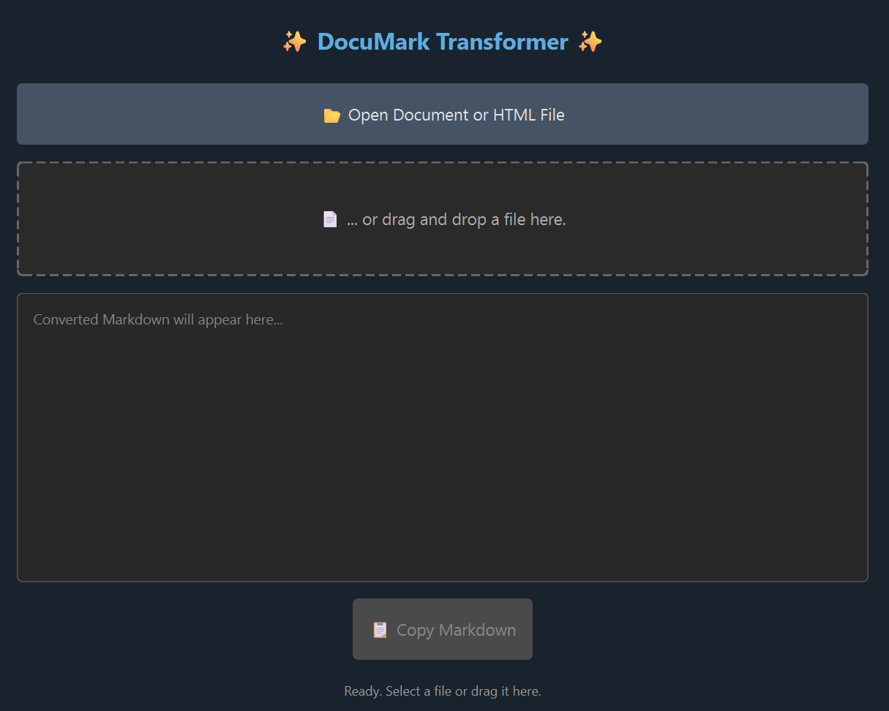

# ✨ DocuMark Transformer ✨

**(Formerly Docling Python GUI)**

[](https://www.python.org/downloads/)
[](https://doc.qt.io/qtforpython/)
[](https://github.com/ColinDuquesnoy/QDarkStyleSheet)
[](https://github.com/docling-project/docling)

A simple and stylish desktop GUI application built with Python and PySide6 to convert various document formats (.pdf, .docx, .pptx, .html) into Markdown using the power of [Docling](https://github.com/docling-project/docling).

---

## 📸 Screenshot


---

## 🚀 Features

* 📄 **Convert Multiple Formats:** Supports `.pdf`, `.docx`, `.pptx`, `.html`, and `.htm` files.
* 🖱️ **Easy Input:** Open files using the standard file dialog or simply drag and drop them onto the application window.
* M↓ **Markdown Output:** View the converted Markdown content directly within the application's text area.
* 📋 **Copy to Clipboard:** Easily copy the generated Markdown with a single button click.
* 🎨 **Dark Theme:** Features a pleasant dark user interface powered by QDarkStyle.
* ⚡ **Fast Startup:** The window opens and accepts files instantly; Docling loads in the background (see [Performance](#-performance)).
* ⏳ **Status Updates:** Provides feedback on the conversion process (Ready, Converting, Success, Error).
* 🛠️ **Platform Workarounds:** Includes built-in attempts to handle common issues like:
    * Hugging Face Hub symlink errors on Windows (`OSError [WinError 1314]`).
    * Drag-and-drop path resolution on newer macOS versions.
* ❗ **Error Handling:** Displays informative error messages for issues like file not found, permission errors, missing dependencies, or conversion failures.

---

## 📂 Supported Input Formats

* PDF Files (`.pdf`)
* Word Documents (`.docx`)
* PowerPoint Presentations (`.pptx`)
* HTML Files (`.html`, `.htm`)

---

## 📋 Requirements

* **Python:** Version 3.8 or higher is recommended.
* **pip:** Python package installer (usually comes with Python).
* **Operating System:** Windows, macOS, or Linux (Tested primarily with Windows/macOS considerations in mind).

---

## ⚙️ Installation & Setup

1.  **Clone or Download:**
    * Clone the repository:
        ```bash
        git clone <your-repository-url>
        cd <your-repository-directory>
        ```
    * Or download the source code ZIP and extract it.

2.  **Create a Virtual Environment (Recommended):**
    ```bash
    python -m venv venv
    # On Windows
    .\venv\Scripts\activate
    # On macOS/Linux
    source venv/bin/activate
    ```

3.  **Install Dependencies:**
    ```bash
    pip install -r requirements.txt
    ```
    * **Note:** On the very first launch, Docling downloads its PDF models (layout, tables, OCR) from Hugging Face Hub in the background. This happens once and requires an internet connection.
    * If you install with `uv`, add `--compile-bytecode` (`uv pip install --compile-bytecode -r requirements.txt`). Otherwise Python compiles thousands of files on the first launch, which makes that launch noticeably slower.

---

## ▶️ Usage

1.  Make sure you have activated your virtual environment (if you created one).
2.  Navigate to the directory containing the script.
3.  Run the application from your terminal:

    ```bash
    python docling_gui.py
    ```

4.  Use the "📂 Open Document or HTML File" button or drag and drop a supported file onto the window.
5.  The converted Markdown will appear in the text area.
6.  Use the "📋 Copy Markdown" button to copy the result.

---

## ⚡ Performance

The slow part of this app is not the GUI: it is importing Docling (and PyTorch under it) and loading its PDF models. The app is built around that:

* **Instant window.** Only Qt is imported before the window appears. You can pick or drop a file right away; it is queued and converts as soon as Docling is ready.
* **Background loading.** Docling is imported in a background thread, then the PDF models are preloaded, so the first PDF does not pay for them. A file picked during loading is converted *before* the model preload.
* **One converter per session.** Models are loaded once, not once per file.
* **No LangChain.** The app calls Docling directly; `langchain-docling` added extra imports (chunking, tokenizers) the app never used. The Markdown output is identical.

Measured on Linux (32 cores, SSD), same machine and documents, before → after:

| | Before | After |
|---|---|---|
| Window can accept a file (cold cache) | 4.2 s | **0.25 s** |
| First DOCX converted, picked at launch (cold cache) | 5.8 s | **3.9 s** |
| First PDF converted, picked at launch | 7.7 s | **6.9 s** |
| Each later PDF in the same session | 2.6 s | **1.2 s** |

To see the timings on your own machine:

```bash
DOCUMARK_TIMING=1 python docling_gui.py          # macOS / Linux
set DOCUMARK_TIMING=1 && python docling_gui.py   # Windows (cmd)
```

---

## Platform Notes

* **Windows:**
    * **Hugging Face Symlink Issue:** Docling uses Hugging Face Hub for model management. On Windows, creating symbolic links (symlinks) often requires administrator privileges or enabling "Developer Mode". This can cause an `OSError: [WinError 1314] A required privilege is not held by the client` when models are downloaded/cached.
    * **Workaround:** This script *automatically* sets the environment variable `HF_HUB_DISABLE_SYMLINKS=1` before importing relevant libraries. This tells Hugging Face Hub to *copy* files instead of using symlinks, avoiding the privilege error. This might use slightly more disk space in the cache (`C:\Users\<YourUser>\.cache\huggingface`).
    * **If Errors Persist:** Although the script tries to prevent it, if you still see WinError 1314, try:
        * Enabling [Developer Mode](https://learn.microsoft.com/en-us/windows/apps/get-started/enable-your-device-for-development) in Windows Settings.
        * Running the script as an Administrator (right-click -> Run as administrator).
        * Checking permissions on your Hugging Face cache directory.

* **macOS:**
    * **Drag and Drop:** Newer macOS versions have stricter sandboxing for drag-and-drop operations. If Qt cannot resolve a dropped file, the app falls back to the `Foundation` library (pyobjc, if installed) to resolve the path.

---

## 🔧 Troubleshooting

* **`ImportError: No module named 'docling'`:** Install the dependencies with `pip install -r requirements.txt` and make sure your virtual environment is active.
* **`ImportError: No module named 'some_dependency'`:** Docling might require extra libraries for specific file types. Check the Docling documentation or the error message for clues.
* **Conversion Fails / Empty Output:**
    * Ensure the input file is not corrupted or password-protected.
    * The document might be empty or have content Docling cannot parse (e.g., image-only PDF without OCR capabilities installed/enabled).
    * Check the console for more detailed error messages printed by the script or underlying libraries.
* **`OSError` / Permission Denied:** Ensure the application has read permissions for the file you are trying to open and write permissions for the Hugging Face cache directory. Check if the file is open in another application.
* **Application Doesn't Start / `qdarkstyle` Error:** Ensure `qdarkstyle` and `PySide6` installed correctly. The application attempts to fall back to default styling if `qdarkstyle` fails to load.

---

## 📦 Core Dependencies

* **PySide6:** Qt for Python bindings (GUI framework).
* **qdarkstyle:** For the dark theme stylesheet.
* **docling:** Handles the core document loading and conversion to Markdown.
* **(Indirect) huggingface_hub:** Used by Docling for model management.

---

## 📄 License

This project is currently unlicensed.

---